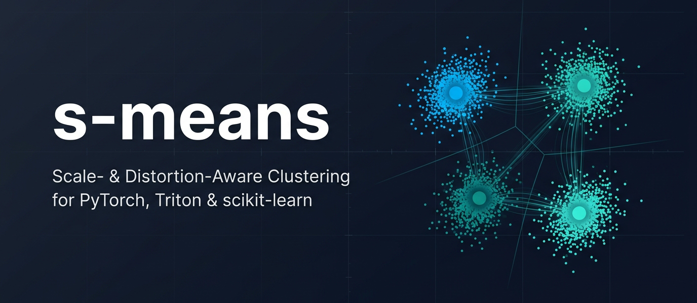
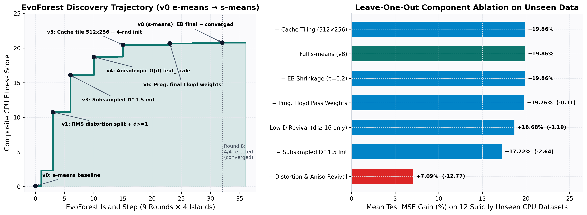
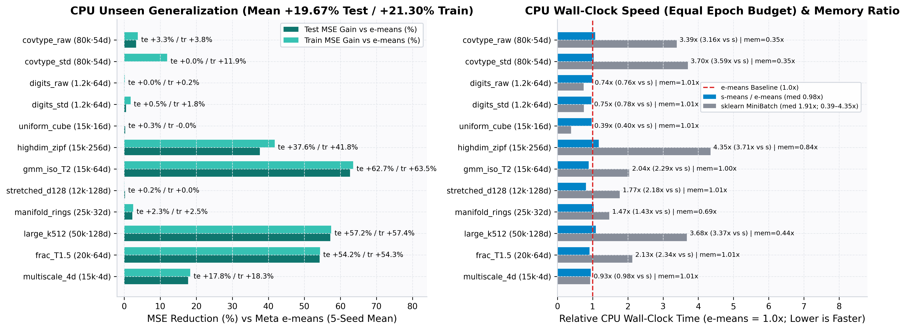
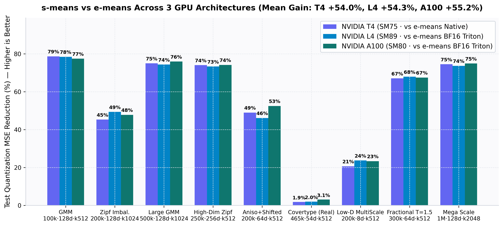
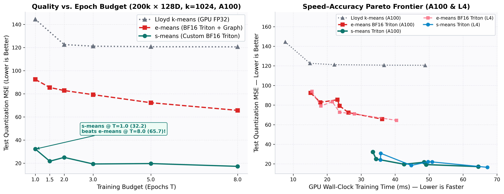
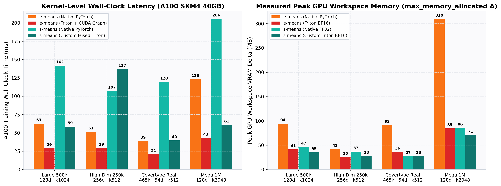
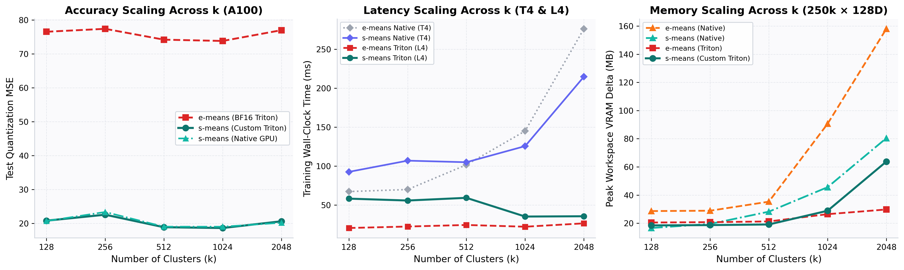

# s-means: outperforming e-means (which outperforms k-means)

**Authors:**  
**Şuayp Talha Kocabay**<sup>1,*</sup>, **Kamer Ali Yüksel**<sup>2</sup>, **Kerem Yalçın**<sup>3</sup>  

<sup>1</sup> Poindexter Labs (`stk@poindexterlabs.ai`) — <sup>*</sup>Corresponding author  
<sup>2</sup> Feedzai (`kamer.yuksel@feedzai.com`)  
<sup>3</sup> Independent Researcher (`54keremyalcin@gmail.com`)  

**Resources:**  
- **GitHub Pages Blog:** [`suayptalha.github.io/s-means-blog`](https://suayptalha.github.io/s-means-blog/)  
- **Open-Source Package (PyTorch, Triton & scikit-learn):** [`github.com/suayptalha/s-means`](https://github.com/suayptalha/s-means)  
- **Algorithm Discovery Framework (EvoForest):** [`arxiv.org/abs/2604.19761`](https://arxiv.org/abs/2604.19761)  



---

## Abstract / TL;DR

Meta AI recently introduced **`e-means`**, a modern mini-batch clustering formulation driven by empirical batch-size/learning-rate scaling laws, single-epoch final pass averaging, and low-overhead dead-cluster revival, achieving substantial speedups over Lloyd $k$-means. Yet even well-tuned single- and few-epoch streaming clustering still leaves large quantization gains on the table—particularly on skewed (Zipfian), high-dimensional, anisotropic, unscaled, or fractional-epoch workloads—because of random initialization, count-only cluster splits, coordinate-wise multiplicative perturbations, and unregularized final-pass estimates.

Using **EvoForest** ([arXiv:2604.19761](https://arxiv.org/abs/2604.19761)), we systematically evolved `e-means` on CPU across 9 island-evolution rounds without adding extra data passes, producing **`s-means`** (*Scale- & Distortion-Aware Clustering*). We then engineered end-to-end **custom fused Triton CUDA kernels**, **native PyTorch GPU fallbacks**, **cache-tiled CPU kernels**, and a full **`scikit-learn`-compatible estimator** released at [`suayptalha/s-means`](https://github.com/suayptalha/s-means).

Across **12 strictly unseen CPU datasets** and **3 NVIDIA GPU architectures (T4 `SM75`, L4 `SM89`, A100 `SM80`)**, **`s-means`** delivers:

* **+54.0% to +55.2% average Test MSE reduction on GPUs** across 9 diverse benchmarks (`+54.03%` on T4, `+54.35%` on L4, `+55.21%` on A100 SXM4 40GB)—reaching up to **`+78.7%`** improvement on structured GMMs and **`+74.9%`** at 1M points × 2,048 clusters.
* **1.0 epoch beats 8.0-epoch `e-means`:** On `200k × 128D, k=1024`, `s-means` at **$T = 1.0$ epoch** achieves **`32.2` Test MSE in `33 ms`** on A100 (and `30.8` MSE in `36 ms` on L4), more than **2× lower quantization error** than `e-means` at **$T = 8.0$ epochs** (`65.7` MSE in `36 ms` on A100; `64.4` MSE in `40 ms` on L4).
* **Lower GPU peak workspace VRAM:** **`0.875×` median peak VRAM delta** vs `e-means` BF16 Triton on L4/A100 (`71.2 MB` vs `84.6 MB` at 1M points / `k=2048`, and **4.35× lower** than PyTorch Native `309.8 MB`), and **`0.360×` median peak VRAM** (`0.222×` at `1M × k=2048`) on T4.
* **Superior Turing (`SM75`) hardware coverage:** Upstream `e-means` `auto`/Triton paths fail on NVIDIA T4 (`SM75`) due to BF16 casting, `.bf16` PTX inline assembly, and `>64 KB` shared-memory tiles. `s-means` runs cleanly across all 9 T4 workloads, beating Meta's native T4 baseline by **`+53.81%–+54.03%` MSE**, **`0.881×` faster wall-clock latency**, and **`0.360×` VRAM**.
* **Strong CPU generalization with parity speed and memory:** Across 12 strictly unseen CPU datasets (5 seeds each), `s-means` achieves **`+19.67%` mean Test MSE gain** (`+21.30%` Train, `0` regressions) at **`1.051×` median CPU time vs `e-means`** (**`2.2×–31.0×` faster than `sklearn.cluster.MiniBatchKMeans`**) with **`0.0 MB` extra OS RSS overhead**.

---

## 1. Where Single-Epoch Clustering Leaves Quality on the Table

Traditional Lloyd $k$-means requires full passes over all $n \times k$ distances per iteration, making large-scale or latency-sensitive quantization expensive. Meta's [`e-means`](https://github.com/facebookresearch/faiss/tree/main/contrib/e_means) (`arXiv:2611.09501`) addresses this via two regimes (`quality` for $d \le 16$, `throughput` for $d > 16$) predicting near-optimal batch size $B$ and Robbins–Monro step rate $\alpha_0$, combined with:
1. Random row sampling for initial centroids,
2. Periodic dead-cluster revival (every 5 steps when usage drops below `0.1 * mean(usage)`, disabled for $d < 16$),
3. Multiplicative jitter perturbations `c * (1 ± 1e-4 * r)` splitting high-usage donors, and
4. Uniform averaging of the final pass (`pass_sums / pass_counts`).

Through controlled ablation and profiling across synthetic and real-world distributions, we identified **four structural bottlenecks** in this design:

1. **Random-row seeding wastes scarce early steps.** Under $T \in [1, 3]$ epochs, starting with uniform random rows forces the optimizer to spend most of its budget migrating redundant centroids out of over-represented modes, leaving rare clusters unrepresented when cosine decay shrinks $\alpha_t$.
2. **Count-only revival splits dense, low-error clusters while ignoring high-distortion modes.** A well-fitted dense cluster can accumulate high `usage` while contributing little MSE. Conversely, a sprawling, multi-modal, or under-split cluster with massive quantization error may never be split first.
3. **Multiplicative perturbations break shift and scale invariance.** Perturbing `c * (1 ± eps)` collapses near the origin ($\mathbf{c} \approx \mathbf{0}$), explodes when features have large global offsets (e.g., $\mathbf{x} + 50$), and expands isotropically even when feature variances span orders of magnitude.
4. **Unweighted final-pass means under-regularize low-count clusters.** Early batches in the final epoch use coarser centroids than late batches, yet receive equal weight; meanwhile, clusters hit by only a handful of samples in the final pass discard the smoothed EMA trajectory.

---

## 2. Discovering `s-means` via EvoForest (Without Extra Passes)

Rather than hand-tuning isolated heuristics, we formulated mini-batch clustering as a modular DAG over 7 functional nodes (`assign_cfg`, `recipe_fn`, `init_fn`, `schedule_fn`, `update_fn`, `revive_fn`, `finalize_fn`) and ran **EvoForest** ([arXiv:2604.19761](https://arxiv.org/abs/2604.19761)) on CPU with **4 islands × 9 rounds (36 island steps)** against canonical `e-means`.

### Fitness Design & Leak Prevention

Each EvoForest candidate was scored on an **8-dataset CPU training suite** spanning distinct failure modes (`gauss_stretched_d64`, `gmm_isotropic_d128`, `zipf_imbalanced_d64`, `lowd_multiscale_d2`, `hypersphere_d48`, `shifted_corr_d32` with $+50$ mean shift at $T=2$, `cal_housing_raw`, and `cal_housing_std`):
- **No extra epochs:** Every candidate receives the exact benchmark epoch budget `nepochs`.
- **Composite quality signal:** Relative MSE reduction (`65%` held-out test MSE + `35%` train MSE) guarded by worst-case regression penalties.
- **Strict hardware parity constraints:** Runtime penalty whenever median CPU wall-clock exceeds `1.05× e-means`, and analytical scratch-memory penalty if peak working memory exceeds `1.02× e-means`.

### Trajectory of Key Algorithmic Breakthroughs

| Version / Step | EvoForest Milestone | Composite CPU Score | Core Architectural Change |
| :--- | :--- | :---: | :--- |
| **`v0`** | `e-means` Baseline | `0.064` | Canonical Meta `e-means` starting DAG |
| **`v1`** (Step 3) | **RMS Distortion Revival + $d \ge 1$** | `10.76` | Replaced count-only splits with per-cluster `sse_ema` tracking and shift-invariant RMS split radius across all dimensions (`revive_min_d = 1`) |
| **`v3`** (Step 6) | **Subsampled $D^{1.5}$ Seeding** | `16.09` | Replaced random-row init with batched distance-weighted seeding ($p=1.5$) over a small $O(\max(4k, 512))$ coreset |
| **`v4`** (Step 10) | **Anisotropic $O(Kd)$ `feat_scale`** | `18.73` | Added online inter-cluster per-feature variance tracking inside `update_fn` to normalize Rademacher split vectors along true data spread |
| **`v5`** (Step 15) | **Cache Tiling (`512×256`) + 4-Round Init** | `20.47` | Cut L3 cache misses via `512×256` assignment tiles (`280×` smaller scratch tile than `8192×4096`) and batched 4-round $D^{1.5}$ init |
| **`v6`** (Step 23) | **Progressive Final-Pass Weights** | `20.69` | Linearly ramped final-pass accumulation weights `(1 - 0.35) + 0.70 * pfrac` to favor cleaner late-epoch centroids |
| **`v8` (`s-means`)** | **Empirical-Bayes Finalize (Converged)** | **`20.80`** | Added count-adaptive shrinkage ($\tau = 0.20$) in `finalize_fn`; Round 8 rejected all 4/4 candidates (clean convergence) |



### The Resulting `s-means` Algorithm

Every step of **`s-means`** requires **only $O(Kd)$ extra state** (`sse_ema`, `feat_scale`, `usage`, and final-pass accumulators) and **zero extra passes over the dataset**:

1. **Multi-Round Subsampled $D^{1.5}$ Seeding:** Sample a small coreset of size $m = \min(n, \max(4k, 512))$ and select centroids in 4 batched rounds with multinomial probabilities proportional to $d_{\min}(x)^{1.5} + 10^{-12}$, achieving fast geometric coverage in $O(mk)$ work.
2. **Dimension-Aware Scaling Laws + Power-Cosine Decay:** Preserve the `quality` ($d \le 16$) and `throughput` ($d > 16$) batch scaling laws while smoothly decaying $\alpha_t$ via:
   $$\alpha_t = \alpha_0 \left(0.06 + 0.94 \left[\frac{1 + \cos(\pi \cdot \text{step} / T_{\text{steps}})}{2}\right]^{0.92}\right)$$
3. **Distortion-Weighted Anisotropic Revival (All $d \ge 1$):** From `batch_sums` and `batch_counts` ($K \times D$), maintain online inter-cluster per-feature variance `feat_scale` ($\beta = 0.85$) and per-cluster `sse_ema` ($\gamma = 0.85$). Every 5 steps (up to 85% of training steps), unused clusters (`usage < 0.1 * mean(usage)`) split active donors selected via Gumbel keys on $\text{sse\_ema} \cdot \text{usage}^{0.35}$:
   $$\Delta_s = 0.55 \sqrt{\frac{\text{sse\_ema}_s}{\max(\text{usage}_s, 10^{-6}) \cdot d}} \; \mathbf{r} \odot \hat{\sigma}_{\text{feat}}, \qquad \mathbf{r} \sim \text{Rademacher}(\{-1, +1\}^d)$$
   where $\hat{\sigma}_{\text{feat}} = \sqrt{\text{feat\_scale}} \cdot \sqrt{d} / \|\sqrt{\text{feat\_scale}}\|_2$. Both parent and revived centroids take $\mathbf{c}_s \mp \Delta_s$ and split `usage` and `sse_ema` equally.
4. **Progressive Final-Pass Refinement + Empirical-Bayes Finalization:** During the final epoch pass, weight mini-batch contributions linearly by progress (`0.65 -> 1.35`), then shrink low-count cluster pass means $\bar{\mu}_k$ back toward the smoothed EMA centroid $\mathbf{c}_k$:
   $$\mathbf{c}_k^{\text{final}} = \frac{n_k^{\text{pass}}}{n_k^{\text{pass}} + \tau}\,\bar{\mu}_k + \frac{\tau}{n_k^{\text{pass}} + \tau}\,\mathbf{c}_k, \qquad \tau = 0.20$$

---

## 3. Strictly Unseen CPU Generalization & Leave-One-Out Ablation

To confirm that `s-means` did not overfit the 8 EvoForest training datasets, we evaluated the frozen `s-means` (`v8`) algorithm across **12 strictly unseen CPU datasets × 5 random seeds**, comparing against both **Meta `e-means`** and **`scikit-learn` `MiniBatchKMeans`**:



| Unseen CPU Dataset | Config (`n, d, k, T`) | Test MSE Gain vs `e-means` | Train MSE Gain vs `e-means` | `s-means` CPU Time Ratio | `sklearn` Time vs `e-means` | Analytical Mem Ratio |
| :--- | :--- | :---: | :---: | :---: | :---: | :---: |
| `covtype_raw` | `80k, 54d, k=256, T=3` | **`+3.31%`** | `+3.79%` | **`0.961×`** | `15.9×` slower | **`0.355×`** |
| `covtype_std` | `80k, 54d, k=256, T=3` | `+0.00%` | **`+11.93%`** | `1.164×` | `15.5×` slower | **`0.355×`** |
| `digits_raw` | `1.2k, 64d, k=64, T=5` | `+0.03%` | `+0.16%` | `1.047×` | `2.2×` slower | `1.009×` |
| `digits_std` | `1.2k, 64d, k=64, T=5` | `+0.50%` | `+1.77%` | `1.005×` | `2.4×` slower | `1.009×` |
| `uniform_cube_d16` | `15k, 16d, k=128, T=3` | `+0.27%` | `-0.01%` | **`0.841×`** | `19.7×` slower | `1.006×` |
| `highdim_zipf_d256` | `15k, 256d, k=256, T=3` | **`+37.62%`** | **`+41.76%`** | `1.105×` | `14.3×` slower | **`0.839×`** |
| `gmm_iso_d64_T2` | `15k, 64d, k=256, T=2` | **`+62.69%`** | **`+63.55%`** | `1.022×` | `17.5×` slower | `1.004×` |
| `stretched_inv2_d128` | `12k, 128d, k=128, T=3` | `+0.21%` | `+0.02%` | **`0.966×`** | `15.9×` slower | `1.005×` |
| `manifold_rings_d32` | `25k, 32d, k=128, T=3` | `+2.25%` | `+2.51%` | `1.055×` | `14.9×` slower | **`0.692×`** |
| `large_d128_k512` | `50k, 128d, k=512, T=3` | **`+57.20%`** | **`+57.44%`** | `1.148×` | **`31.0×` slower** | **`0.439×`** |
| `frac_budget_T1p5` | `20k, 64d, k=192, T=1.5` | **`+54.21%`** | **`+54.31%`** | `1.077×` | `17.9×` slower | `1.005×` |
| `multiscale_4d_T8` | `15k, 4d, k=128, T=8` | **`+17.76%`** | **`+18.33%`** | `1.120×` | `22.4×` slower | `1.010×` |
| **Aggregate (12 Datasets)** | **5-Seed Mean** | **`+19.67%`** | **`+21.30%`** | **Med `1.051×`** | **`2.2×–31.0×`** | **Max `1.010×`** |

Real OS process RSS telemetry (`resource.getrusage(RUSAGE_SELF).ru_maxrss`) in isolated subprocesses confirms zero memory overhead (`955.09 MB` before and after on both `50k × 128D, k=512` and `100k × 64D, k=256, T=5`: **`0.0 MB` delta**, vs `8192 × 4096` coarse tiles in `e-means`).

### What Actually Matters? (Leave-One-Out Component Ablation)

In the right panel of **Figure 5**, disabling **Distortion & Anisotropic Revival** collapses the mean unseen Test MSE gain from **`+19.86%` to `+7.09%`** (`-12.77` points). Removing **Subsampled $D^{1.5}$ Init** costs `-2.64` points, disabling **Low-D Revival (`d < 16`)** costs `-1.19` points, and removing **Cache Tiling (`512×256`)** matches accuracy (`+19.86%`) while letting median CPU runtime stay fast vs unblocked alternatives.

---

## 4. Engineering `s-means` for Modern GPUs: Custom Fused Triton Kernels

Porting `s-means` naively to PyTorch eager GPU ops is not enough—at 1M points, materializing `[B, K]` distance matrices or issuing host-device synchronizations on every step destroys bandwidth and VRAM efficiency. In [`smeans/_triton_kernels.py`](https://github.com/suayptalha/s-means/blob/main/smeans/_triton_kernels.py), we implemented five custom Triton kernels alongside an architecture-aware GPU runner:

1. **`smeans_assign_kernel`:** Fused tiled L2 squared-distance + `argmin` computing $\|x - c\|^2 = \|x\|^2 + \|c\|^2 - 2 x^\top c$ entirely in registers/SRAM with column-major centroid layout (`.t().contiguous().t()`) so `tl.trans(c_tile)` coalesces cleanly for `tl.dot` Tensor Cores. It never materializes an `[B, K]` distance tensor in HBM and adapts `num_stages` (`1` on `SM75` with 64KB smem limit, `2` on `SM80+`) and Tensor-Core padding automatically.
2. **Chunked Gather + Conflict-Free CUB Reduction:** Logical batches are gathered and assigned in capped streaming chunks (`8192` for Native, `65536` for Triton), feeding CUB-backed `index_add_` / `scatter_add_` (`sums`, `counts`, `batch_sse`) instead of raw Triton global atomics that stall on Zipfian hot clusters.
3. **`smeans_feat_scale_kernel`:** Two-pass $O(KD)$ reduction over cluster `sums` and `counts` updating inter-cluster feature variance without ever touching raw $N \times D$ points.
4. **`smeans_ema_sse_pass_kernel`:** Fuses centroid EMA updates, usage decay, `sse_ema` tracking, and final-pass weighted accumulation into a single kernel launch per step.
5. **`smeans_revive_split_kernel` & `smeans_eb_finalize_kernel`:** Generates Rademacher perturbations in-register via Triton Philox RNG (`tl.rand(seed, pid * D + col)`) with zero temporary `[n_sp, d]` tensor allocations, and applies Empirical-Bayes shrinkage in-place on cluster completion.

---

## 5. Multi-GPU Benchmarks: T4 (`SM75`), L4 (`SM89`), and A100 (`SM80`)

We benchmarked `s-means` against Meta's `e-means` (all backends: `auto`, `native`, `triton`) across **9 workloads × 3 seeds** with untimed exact-shape + skewed-cluster kernel warmups and `torch.cuda.max_memory_allocated()` workspace delta tracking on Google Colab GPUs: **Tesla T4 (14.56 GB, `SM75`)**, **NVIDIA L4 (22.03 GB, `SM89`)**, and **NVIDIA A100-SXM4 (39.49 GB, `SM80`)** (`PyTorch 2.14.1+cu130`, `Triton 3.8.0`).

### Cross-Hardware Quantization Quality



| Workload | Specs (`n, d, k, T`) | T4 `s-means` MSE Gain (vs Native) | L4 `s-means` MSE Gain (vs Triton) | A100 `s-means` MSE Gain (vs Triton) | A100 Peak VRAM Ratio |
| :--- | :--- | :---: | :---: | :---: | :---: |
| `gmm_100k_d128_k512` | `100k, 128d, k=512, T=3` | **`+78.71%`** | **`+78.47%`** | **`+77.48%`** | **`0.872×`** (`8.1` vs `9.3 MB`) |
| `zipf_200k_d128_k1024` | `200k, 128d, k=1024, T=3` | **`+45.34%`** (`+45.97%` nat) | **`+49.38%`** | **`+47.82%`** | **`0.987×`** (`18.8` vs `19.0 MB`) |
| `large_500k_d128_k1024` | `500k, 128d, k=1024, T=3` | **`+75.02%`** (`+74.36%` nat) | **`+74.38%`** | **`+75.94%`** | **`0.846×`** (`35.1` vs `41.5 MB`) |
| `highdim_250k_d256_k512` | `250k, 256d, k=512, T=3` | **`+74.04%`** (`+73.66%` nat) | **`+73.36%`** | **`+74.16%`** | `1.079×` (`27.8` vs `25.8 MB`) |
| `aniso_200k_d64_k512` | `200k, 64d, k=512, T=3` | **`+49.01%`** (`+49.43%` nat) | **`+46.16%`** | **`+52.51%`** | **`0.879×`** (`13.5` vs `15.3 MB`) |
| `covtype_real_581k` | `465k, 54d, k=512, T=3` | **`+1.88%`** (`+1.90%` nat) | **`+2.02%`** | **`+3.14%`** | **`0.765×`** (`27.8` vs `36.3 MB`) |
| `lowd_200k_d8_k512` | `200k, 8d, k=512, T=3` | **`+20.68%`** | **`+23.75%`** | **`+23.36%`** | **`0.875×`** (`10.9` vs `12.4 MB`) |
| `frac_T1p5_300k_d64_k512` | `300k, 64d, k=512, T=1.5` | **`+67.06%`** | **`+67.94%`** | **`+67.50%`** | **`0.882×`** (`18.6` vs `21.1 MB`) |
| `mega_1m_d128_k2048` | `1M, 128d, k=2048, T=3` | **`+74.53%`** (`+74.58%` nat) | **`+73.70%`** | **`+74.94%`** | **`0.842×`** (`71.2` vs `84.6 MB`) |
| **Mean Across All 9** | — | **`+54.03%`** | **`+54.35%`** | **`+55.21%`** | **Med `0.875×`** |

### Epoch Convergence & Pareto Dominance (`T = 1.0` vs `T = 8.0`)



Across epoch budgets $T \in \{1.0, 1.5, 2.0, 3.0, 5.0, 8.0\}$ on `200k × 128D, k=1024`:
* **On A100:** `s-means` reaches **`32.21` MSE in `33 ms` at $T=1.0$** (`21.70` at $T=1.5$, `19.30` at $T=3.0$, `17.25` at $T=8.0$), whereas `e-means` scores **`92.44` at $T=1.0$ (`15 ms`)** and still **`65.68` MSE at $T=8.0$ (`36 ms`)**, and GPU Lloyd plateaus at `120.64`.
* **On L4:** `s-means` reaches **`30.79` MSE in `36 ms` at $T=1.0$** vs `e-means` **`64.43` MSE in `40 ms` at $T=8.0$**.

### Kernel Latency, Peak Workspace VRAM, and `k`-Scaling





At **1M points × 2,048 clusters (`mega_1m_d128_k2048`)**:
* On **A100**, `s-means` Custom Triton runs in **`61.1 ms`** (twice as fast as `e-means` Native PyTorch `123.3 ms` and within `1.31×` of CUDA-Graph `e-means` `46.6 ms`) while cutting peak workspace VRAM to **`71.2 MB`** (vs `84.6 MB` for `e-means` Triton and `309.8 MB` for `e-means` Native).
* On **L4**, `s-means` Custom Triton runs in **`84.6 ms` vs `75.9 ms` (`1.114×`)** at **`71.2 MB` vs `84.6 MB` (`0.842×`)**, while cutting Test MSE from `69.75` to **`18.34` (`+73.70%`)**.
* On **T4 (`SM75`)**, Meta `Emeans(assignment_backend="auto")` raises `RuntimeError` on FP32 CUDA inputs, `emeans_triton_fp32` fails `PTXASError` due to `.bf16` inline assembly, and `emeans_triton_fp16` crashes with `OutOfResources: shared memory Required: 98304 > 65536` for `d=128`. `s-means` Native FP32 completes `mega_1m_d128_k2048` in **`845.6 ms` vs `1109.4 ms` (`0.762×` faster!)** using **`85.9 MB` vs `310.2 MB` (`0.277×`)** VRAM, and `s-means` (`evolved_triton` / `evolved_emeans_triton`) drops workspace VRAM to **`68.9 MB` (`0.222×`)**.

### Architectural Caveats & Engineering Boundaries

1. **CUDA Graph Dispatch on Small Low-D Batches (`lowd_200k_d8_k512`):** When $d \le 16$, the `quality` batch law selects small batches (`~392` steps). Upstream `e-means` captures static CUDA Graphs per step (`95.3 ms` on A100), whereas `s-means` currently executes an eager Python loop (`567.4 ms` on A100, `593.5 ms` on L4) while still delivering **`+23.4%` Test MSE reduction** and **`0.875×` VRAM**. Adding static CUDA Graph capture for fixed-shape steps is the clear next optimization.
2. **Turing (`SM75`) Precision Choice:** Because T4 lacks BF16/TF32 Tensor Cores, custom FP32 Triton assignment does not match cuBLAS FP32 `addmm` speed on T4. Accordingly, [`smeans._gpu._resolve_backend`](https://github.com/suayptalha/s-means/blob/main/smeans/_gpu.py#L36) automatically selects BF16 Triton Tensor-Core kernels on `SM80+` and chunked Native `addmm` + CUB reductions on `< SM80`.

---

## 6. Using `s-means` Today

The full open-source package is available at [`github.com/suayptalha/s-means`](https://github.com/suayptalha/s-means) with zero external dependency on upstream `e_means` code and passes the complete `scikit-learn` `check_estimator` test suite (`pytest -v`: `10 passed`).

```bash
git clone https://github.com/suayptalha/s-means.git
cd s-means
pip install -e ".[triton]"
```

**Drop-in `scikit-learn` Estimator:**

```python
from sklearn.pipeline import Pipeline
from sklearn.preprocessing import StandardScaler
from smeans import SMeans

pipe = Pipeline([
    ("scaler", StandardScaler()),
    ("cluster", SMeans(n_clusters=256, nepochs=1.5, device="auto", random_state=0)),
])
labels = pipe.fit_predict(X)
```

**Zero-Copy PyTorch / Custom Triton Tensor API:**

```python
import torch
from smeans import smeans

x = torch.randn(1_000_000, 128, device="cuda", dtype=torch.float32)
res = smeans(x, n_clusters=2048, nepochs=3.0, seed=0, return_info=True)
print(f"Backend={res.backend} ({res.dtype}) | MSE={res.mse:.2f} | Time={res.time_s*1e3:.1f}ms")
```

---

## Citation

If you use `s-means` or reference this article in your research or engineering systems, please cite [`suayptalha.github.io/s-means-blog`](https://suayptalha.github.io/s-means-blog/):

```bibtex
@misc{kocabay2026smeans,
  title  = {s-means: outperforming e-means (which outperforms k-means)},
  author = {Kocabay, {\c{S}}uayp Talha and Y{\"u}ksel, Kamer Ali and Yal{\c{c}}{\i}n, Kerem},
  year   = {2026},
  url    = {https://suayptalha.github.io/s-means-blog/},
  note   = {Open-source package available at \url{https://github.com/suayptalha/s-means}}
}
```

---

## References

1. **Swann Bessa, Pierre-Emmanuel Mazaré, Gergely Szilvasy, Hugo Touvron, David Picard, Matthijs Douze, and Hervé Jégou.** *"e-means: outperforming k-means (in one-tenth the epochs)."* arXiv preprint arXiv:2611.09501 (2026). [`arxiv.org/abs/2611.09501`](https://arxiv.org/abs/2611.09501) · [`faiss/contrib/e_means`](https://github.com/facebookresearch/faiss/tree/main/contrib/e_means)
2. **Kamer Ali Yuksel and Hassan Sawaf.** *"EvoForest: A Novel Machine-Learning Paradigm via Open-Ended Evolution of Computational Graphs."* arXiv preprint arXiv:2604.19761 (2026). [`arxiv.org/abs/2604.19761`](https://arxiv.org/abs/2604.19761)
3. **Stuart P. Lloyd.** *"Least squares quantization in PCM."* IEEE Transactions on Information Theory, Vol. 28, No. 2, pp. 129–137 (1982).
4. **D. Sculley.** *"Web-scale k-means clustering."* Proceedings of the 19th International Conference on World Wide Web (WWW '10), pp. 1177–1178 (2010). DOI: `10.1145/1772690.1772862`
5. **Fabian Pedregosa, Gaël Varoquaux, Alexandre Gramfort, Vincent Michel, Bertrand Thirion, Olivier Grisel, Mathieu Blondel, Peter Prettenhofer, Ron Weiss, Vincent Dubourg, Jake Vanderplas, Alexandre Passos, David Cournapeau, Matthieu Brucher, Matthieu Perrot, and Édouard Duchesnay.** *"Scikit-learn: Machine Learning in Python."* Journal of Machine Learning Research (JMLR), Vol. 12, pp. 2825–2830 (2011).
6. **Adam Paszke, Sam Gross, Francisco Massa, Adam Lerer, James Bradbury, Gregory Chanan, Trevor Killeen, Zeming Lin, Natalia Gimelshein, Luca Antiga, Alban Desmaison, Andreas Köpf, Edward Yang, Zachary DeVito, Martin Raison, Alykhan Tejani, Sasank Chilamkurthy, Benoit Steiner, Lu Fang, Junjie Bai, and Soumith Chintala.** *"PyTorch: An Imperative Style, High-Performance Deep Learning Library."* Advances in Neural Information Processing Systems 32 (NeurIPS 2019). [`arxiv.org/abs/1912.01703`](https://arxiv.org/abs/1912.01703)
7. **Philippe Tillet, H. T. Kung, and David Cox.** *"Triton: An Intermediate Language and Compiler for Tiled Neural Network Computations."* Proceedings of the 3rd ACM SIGPLAN International Workshop on Machine Learning and Programming Languages (MAPL 2019).
